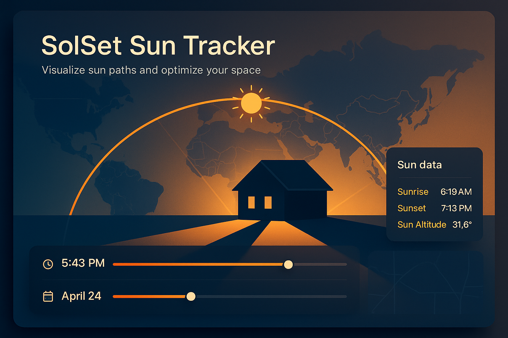

# SolSet — Sun Position Tracker

<div align="center">



**A beautiful, interactive web application for visualizing the sun's position and trajectory.**

[Live Demo](https://solset.guztia.com) · [Report Bug](https://github.com/rouralberto/solset/issues) · [Request Feature](https://github.com/rouralberto/solset/issues)

</div>

---

## ✨ Features

### 🗺️ Interactive Map
- OpenStreetMap and ESRI satellite imagery options
- Click anywhere to set location
- Smooth panning with real-time sun updates
- Center crosshair indicator with compass labels
- Remembers your preferred base layer

### ☀️ Sun Visualization
- Daily sun trajectory arc
- Current sun position marker
- Sunrise/sunset time markers
- Shadow projection from center point
- Correct local times using the location's real time zone (including DST)

### 📅 Time Control
- Intuitive date and time sliders with color gradients
- Quick date jumps (solstices, equinoxes)
- Direct keyboard input for precise times
- Play through the day (skips the night)
- Keyboard shortcuts for fast navigation

### 🏠 House Orientation
- Optimal house orientation calculator
- Day/Night zone visualization
- Real-time shadow projection
- Toggle auto-orientation or set the orientation manually

### 🌍 Seasonal Analysis
- Toggle seasonal sun paths (solstices & equinoxes, labelled for your hemisphere)
- Compare summer vs winter sun exposure
- Visual legend with color coding

### 🎨 Modern UI/UX
- Light and dark mode themes
- System preference detection
- Beautiful gradient sliders
- Responsive layout for phones and tablets
- Keyboard shortcuts
- Settings panel with customization

### 💾 Persistence
- URL state sharing (bookmark any view)
- Recent locations history
- Saved locations (bookmark button in the Sun Data panel)
- Export data to JSON

---

## 🎹 Keyboard Shortcuts

| Key | Action |
|-----|--------|
| `←` `→` | Adjust time ±15 minutes |
| `⇧` + `←` `→` | Adjust date ±1 day |
| `N` | Jump to current date/time |
| `Space` | Play/pause time animation |
| `H` | Toggle house layout |
| `S` | Toggle seasonal paths |
| `D` | Toggle light/dark mode |
| `?` | Show shortcuts help |
| `Esc` | Close modals |

---

## 🛠️ Tech Stack

- **Vue.js 3.5** - Composition API with script setup
- **Vite 6** - Fast build tool and dev server
- **Leaflet.js 1.9** - Interactive map rendering
- **SunCalc.js 1.9** - Astronomical calculations
- **tz-lookup** - Offline time zone lookup for coordinates
- **Bootstrap Icons** - Icon library

---

## 🚀 Getting Started

### Prerequisites

- Node.js 18+ (LTS recommended)
- npm or yarn

### Installation

```bash
# Clone the repository
git clone https://github.com/rouralberto/solset.git
cd solset

# Install dependencies
npm install

# Start development server
npm run dev
```

Open [http://localhost:5173](http://localhost:5173) in your browser.

### Building for Production

```bash
npm run build
```

The built files will be in the `dist` directory.

---

## 🌐 Deployment

This is a static site that can be deployed to any hosting service:

### AWS S3
```bash
./deploy.sh s3 your-bucket-name
```

### Alibaba Cloud OSS
```bash
./deploy.sh oss your-bucket-name
```

### Vercel / Netlify
Just connect your repository and deploy automatically.

---

## ⚙️ Customization

### Settings Panel
Access via the ⚙️ icon in the header:

- **Theme**: Light, Dark, or System (saved in your browser)
- **Shadow Height**: Custom object height for shadow calculation (default: 1m)
- **Solar System Size**: Custom kW for production estimates (default: 6.7kW)
- **House Layout**: Toggle visibility and auto-orientation
- **Locations**: Open or remove saved and recent locations

### URL Parameters
Share specific views with the share button in the header, or by copying the URL. Parameters include:
- `lat`, `lng` - Location coordinates
- `z` - Map zoom level
- `date` - Date in `YYYY-MM-DD` format
- `time` - Time in `HH:MM` format

Date and time are local to the location (not to the viewer), so a shared link shows the same sun position for everyone.

Example: `https://solset.guztia.com/#lat=43.3183&lng=-1.9812&z=15&date=2024-06-21&time=12:00`

---

## 📊 Data Sources

- **Sun Calculations**: [SunCalc](https://github.com/mourner/suncalc) by Vladimir Agafonkin
- **Maps**: [OpenStreetMap](https://www.openstreetmap.org/) and [ESRI](https://www.esri.com/)
- **Geocoding**: [Nominatim API](https://nominatim.org/) (searches run only on submit, per the [usage policy](https://operations.osmfoundation.org/policies/nominatim/))
- **Time zones**: [tz-lookup](https://github.com/photostructure/tz-lookup)

---

## 🤝 Contributing

Contributions are welcome! Please feel free to submit a Pull Request.

1. Fork the project
2. Create your feature branch (`git checkout -b feature/AmazingFeature`)
3. Commit your changes (`git commit -m 'Add some AmazingFeature'`)
4. Push to the branch (`git push origin feature/AmazingFeature`)
5. Open a Pull Request

---

## 📄 License

This project is licensed under the MIT License - see the [LICENSE](LICENSE) file for details.

---

## 🙏 Acknowledgements

- [SunCalc](https://github.com/mourner/suncalc) for precise astronomical calculations
- [Leaflet](https://leafletjs.com/) for the excellent mapping library
- [OpenStreetMap](https://www.openstreetmap.org/) contributors for map data
- [tz-lookup](https://github.com/photostructure/tz-lookup) for offline time zone lookup

---

<div align="center">

Made with ☀️ by [Alberto Roura](https://github.com/rouralberto)

</div>
