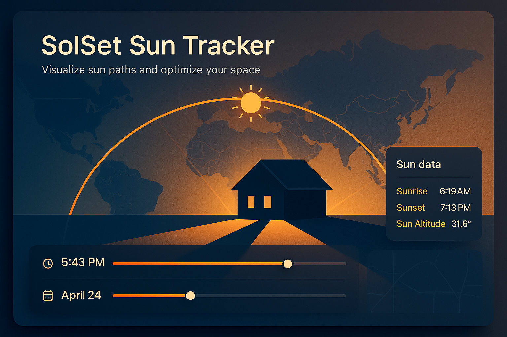

# SolSet — Sun path, shadows & solar for siting a house

<div align="center">



**Place and orient a new house by the sun: see the sun's path and real-scale shadows on a map, check what shades the plot, and estimate rooftop solar.**

[Live Demo](https://solset.guztia.com) · [Report Bug](https://github.com/rouralberto/solset/issues) · [Request Feature](https://github.com/rouralberto/solset/issues)

</div>

---

## ✨ Features

### 🗺️ Interactive Map
- OpenStreetMap and ESRI satellite imagery; zooms in to plot level (beyond the native tile resolution)
- Click anywhere to set location; the house sits at the map centre, so dragging the map places it on the plot
- House, surrounding objects and their **shadows drawn to true scale**, with a scale bar
- Sky dome with compass, the day's sun path, sunrise/sunset points and optional solstice/equinox paths
- Remembers your preferred base layer

### ☀️ Sun
- Sun position, sunrise/sunset times **and bearings**, civil twilight, day length
- Solar noon versus clock noon (the two are often an hour or more apart)
- Shadow length and direction for an object of any height
- **Sun-path chart** (height against compass direction) for the solstices, the equinox and the selected day, with a table of the same figures
- **True vs magnetic north**: magnetic declination from the World Magnetic Model, so a compass or a site plan can be corrected
- Correct local times using the location's real time zone (including DST)

### 🏠 House
- House footprint, wall height and roof pitch in real dimensions
- **Best orientation from local climate**: weighs useful winter sun against unwanted hot-weather sun through the glazing, using monthly climate normals. Works in heating climates, mixed climates and the tropics
- **How much an off-ideal orientation costs**: "useful winter sun: 93% of the best", "hot-weather sun: +22%", and a colour strip showing the good range
- **Sun on each side**: hours of direct sun per wall on the solstices and equinox, when the sun is on each wall today, and which rooms suit each side
- **Window overhang calculator**: section drawing, depth needed for full summer shade, and the share of direct sun blocked month by month, for any wall

### 🌳 Shading
- Place trees and buildings on the map (drag to move, edit height and size)
- **Import neighbouring buildings from OpenStreetMap**, with missing heights flagged
- **Terrain horizon**: hills and mountains up to 40 km away, ray-marched from open elevation data
- Hours of sun reaching the day side on the key dates, including the 9am–3pm midwinter window used by solar-access rules

### ⚡ Solar
- Yearly and month-by-month production for a roof plane or any tilt and direction
- Compared with the best fixed position for the site, with shading losses from surroundings and terrain
- In-browser irradiance model on NASA POWER climate normals; checked against PVGIS at 12 sites worldwide (mean absolute difference under 6%)

### 📄 Site report
- One-click printable report (or save as PDF): sun-path chart, **shadow diagrams at 9:00, 12:00 and 15:00** for the solstices and equinox with north arrow and scale bar, sun per wall, overhang and solar tables, and the assumptions behind them

### 📅 Time Control
- Intuitive date and time sliders with color gradients
- Quick date jumps (solstices, equinoxes)
- Direct keyboard input for precise times
- Play through the day (skips the night)
- Keyboard shortcuts for fast navigation

### 🎨 Modern UI/UX
- Light and dark mode themes, system preference detection
- Metric or imperial lengths
- Responsive layout for phones and tablets

### 💾 Persistence
- URL state sharing (location, date, time and house)
- Recent and saved locations
- Trees and buildings are kept in your browser
- Export data to JSON

---

## 🎹 Keyboard Shortcuts

| Key | Action |
|-----|--------|
| `←` `→` | Adjust time ±15 minutes |
| `⇧` + `←` `→` | Adjust date ±1 day |
| `N` | Jump to current date/time |
| `Space` | Play/pause time animation |
| `H` | Toggle the house |
| `S` | Toggle seasonal paths |
| `D` | Toggle light/dark mode |
| `R` | Open the site report |
| `Del` | Remove the selected tree or building |
| `?` | Show shortcuts help |
| `Esc` | Close dialogs, cancel placing |

---

## 🛠️ Tech Stack

- **Vue.js 3.5** - Composition API with script setup
- **Vite 8** - Fast build tool and dev server
- **Leaflet.js 1.9** - Interactive map rendering
- **SunCalc 2** - Astronomical calculations
- **tz-lookup** - Offline time zone lookup for coordinates
- **geomagnetism** - World Magnetic Model for magnetic declination
- **Bootstrap Icons** - Icon library

No backend: everything is calculated in the browser.

### How the numbers are made

| | Method |
|---|---|
| Sun position and times | SunCalc (Meeus' algorithms, about 0.1°) |
| Irradiance on roofs and walls | Monthly-average method from Duffie & Beckman: Erbs diffuse split, Collares-Pereira & Rabl daily profile, Hay–Davies sky model ([src/lib/solar.js](src/lib/solar.js)) |
| Solar yield | The above with cell-temperature and 14% system losses; typically within about 10% of PVGIS |
| Best orientation | Useful (heating-season) minus unwanted (hot-weather) solar gain through the glazing, most of it on the day side under a typical eave |
| Shade | A 360° horizon mask per viewpoint, from placed objects, imported buildings and terrain |

These are early-design figures: a guide for siting decisions, not a replacement for an energy model or a surveyed shadow study where one is required.

---

## 🚀 Getting Started

### Prerequisites

- Node.js 18+ (LTS recommended)
- npm or yarn

### Installation

```bash
# Clone the repository
git clone https://github.com/rouralberto/solset.git
cd solset

# Install dependencies
npm install

# Start development server
npm run dev
```

Open [http://localhost:5173](http://localhost:5173) in your browser.

### Building for Production

```bash
npm run build
```

The built files will be in the `dist` directory.

### Tests

```bash
npm test
```

Runs the unit tests for the solar, shading and geodesy calculations (Node's built-in test runner, no extra dependencies).

---

## 🌐 Deployment

This is a static site that can be deployed to any hosting service:

### AWS S3
```bash
./deploy.sh s3 your-bucket-name
```

### Alibaba Cloud OSS
```bash
./deploy.sh oss your-bucket-name
```

### Vercel / Netlify
Just connect your repository and deploy automatically.

---

## ⚙️ Customization

### Settings Panel
Access via the ⚙️ icon in the header:

- **Theme**: Light, Dark, or System (saved in your browser)
- **Units**: Metric or imperial lengths
- **Locations**: Open or remove saved and recent locations

The house, overhang, surroundings and solar array are edited in the **House**, **Shading** and **Solar** tabs of the sidebar.

### URL Parameters
Share specific views with the share button in the header, or by copying the URL. Parameters include:
- `lat`, `lng` - Location coordinates
- `z` - Map zoom level
- `date` - Date in `YYYY-MM-DD` format
- `time` - Time in `HH:MM` format
- `o` - Bearing the house's day side faces, in degrees from true north, or `auto`
- `house` - House width, depth, wall height (metres) and roof pitch (degrees), e.g. `12,8,5.5,30`

Date and time are local to the location (not to the viewer), so a shared link shows the same sun position for everyone.

Example: `https://solset.guztia.com/#lat=43.3183&lng=-1.9812&z=19&date=2026-12-21&time=12:00&o=170&house=12,8,5.5,30`

Opening a link applies its house to your own setup. Trees and buildings are not part of the link.

---

## 📊 Data Sources

- **Sun Calculations**: [SunCalc](https://github.com/mourner/suncalc) by Vladimir Agafonkin
- **Maps**: [OpenStreetMap](https://www.openstreetmap.org/) and [ESRI](https://www.esri.com/)
- **Geocoding**: [Nominatim API](https://nominatim.org/) (searches run only on submit, per the [usage policy](https://operations.osmfoundation.org/policies/nominatim/))
- **Time zones**: [tz-lookup](https://github.com/photostructure/tz-lookup)
- **Climate normals** (sunshine, temperature): [NASA POWER](https://power.larc.nasa.gov/) climatology, fetched once per area and cached in the browser. Offline, a typical climate for the latitude is used and labelled as such
- **Terrain**: [Terrain Tiles](https://registry.opendata.aws/terrain-tiles/) (Mapzen/Tilezen Terrarium) on AWS Open Data, loaded only when "Hills & mountains" is switched on
- **Neighbouring buildings**: [Overpass API](https://overpass-api.de/) (© OpenStreetMap contributors, ODbL), queried only when you press "Import"
- **Magnetic declination**: NOAA/NCEI [World Magnetic Model](https://www.ncei.noaa.gov/products/world-magnetic-model) via [geomagnetism](https://github.com/naturalatlas/geomagnetism)

---

## 🤝 Contributing

Contributions are welcome! Please feel free to submit a Pull Request.

1. Fork the project
2. Create your feature branch (`git checkout -b feature/AmazingFeature`)
3. Commit your changes (`git commit -m 'Add some AmazingFeature'`)
4. Push to the branch (`git push origin feature/AmazingFeature`)
5. Open a Pull Request

---

## 📄 License

This project is licensed under the MIT License - see the [LICENSE](LICENSE) file for details.

---

## 🙏 Acknowledgements

- [SunCalc](https://github.com/mourner/suncalc) for precise astronomical calculations
- [Leaflet](https://leafletjs.com/) for the excellent mapping library
- [OpenStreetMap](https://www.openstreetmap.org/) contributors for map data
- [tz-lookup](https://github.com/photostructure/tz-lookup) for offline time zone lookup

---

<div align="center">

Made with ☀️ by [Alberto Roura](https://github.com/rouralberto)

</div>
